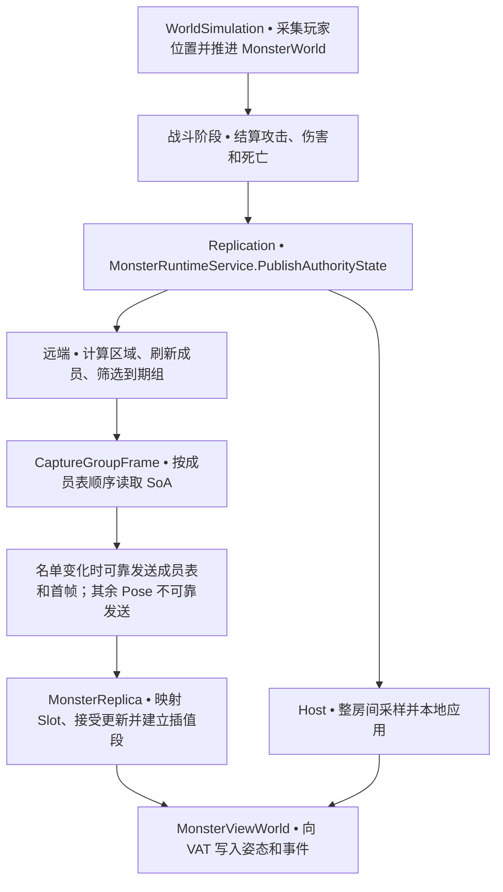

# 怪物网络同步架构解析

本文沿当前源码，从服务端结算后的怪物状态读到客户端 VAT 使用的插值姿态。设计沿革和历史基线见[重构方案](怪物网络层分层分组分频与传输重构方案.md)。

## 1. 权威状态到远端画面的调用链



[`MonsterRuntimeService`](../Assets/_HotUpdate/Scripts/GameProcess/Monster/Runtime/MonsterRuntimeService.cs) 是房间生命周期和 Tick 回调的入口。[`MonsterRoomRuntime`](../Assets/_HotUpdate/Scripts/GameProcess/Monster/Runtime/MonsterRoomRuntime.cs) 持有 `MonsterWorld`、玩家位置缓冲、空间索引和网络群组索引。`MonsterWorld` 按 Slot 分列保存 `Meta`、`Motion` 和 `Presentation` 等数据。服务端在战斗阶段之后才采样，因此捕获的是本 Tick 结算后的活跃成员、位置、朝向和表现序列。

远端路线在有活动房间和远端客户端时运行。同一份房间级分组和计划发给所有远端。Host 继续通过本地整房间快照更新自己的 Replica 和 View，这条路线没有网络往返。

## 2. 从权威坐标得到群组与层级

`MonsterRoomRuntime.Tick` 从玩家管理器采集已出生且存活的玩家，把世界 X/Z 放到 `MonsterPlayerTargetBuffer.Positions`。复制阶段调用 `RefreshNetworkGroups`，用 `AsSpan(0, Count)` 将当前有效位置交给 `MonsterNetworkGroupIndex.Refresh`，直接借用数组的有效区间。

### 2.1 固定基础区域

[`MonsterQuadTreeKernel`](../Assets/_AOT/Scripts/Core/Spatial/MonsterQuadTreeKernel.cs) 规定 `BaseDepth = 4`。每层有四个子象限，四层合计 256 个基础区域。`GetBaseRegionCode(position)` 从根中心和半边长开始走四层，每次把所在象限写入区域码的低两位。`GetBaseRegionCenter(code)` 反向读取这四段象限，恢复区域中心。区域半边长为根半边长的 `1 / 16`。

这里要区分两种“叶节点”。四叉树为了服务碰撞查询，初始化时总是先建立完整的第 4 层基础树。只有某个第 4 层叶节点内的怪物数量超过 `SplitThreshold = 16` 时，碰撞树才继续把它细分到第 5 层或第 6 层，最大深度为 `MaxDepth = 6`。截图中的 `d5`、`d6` 就是这些碰撞查询叶节点。它们描述的是碰撞候选裁剪粒度，不是网络群组边界。

| 象限 | 两位编码 |
|---|---|
| 左下 | `00` |
| 右下 | `01` |
| 左上 | `10` |
| 右上 | `11` |

举例，`11 00 01 10` 表示从根依次走右上、左下、右下、左上。到区域分界线时，和碰撞树一样，`x >= center.x` 选右，`z >= center.z` 选上。密集区域的碰撞叶节点可以继续细分到第 5、6 层，网络仍使用这个四层前缀。网络不会读取某个 Slot 当前落在哪个 d5/d6 叶节点，也不会因为碰撞树发生分裂而改变网络区域码。

两条路径在同一个内核里复用 `GetQuadrant` 和 `GetChildCenter`。网络直接从 `World.Motion[slot].Position` 算出四层前缀，因此碰撞树尚未构建时也能分组。`EnsureBuilt` 仍在需要实体叶节点的碰撞查询路径上执行。地图和玩法位置在树根范围内是当前项目约定。

因此，网络分组依赖的是下面这组固定区域关系：

```text
房间根范围
  └── BaseDepth = 4 的固定区域码
        ├── Region A
        │     ├── Group 1，最多 128 个 Slot
        │     └── Group 2，超过 128 个 Slot 后创建
        └── Region B
              └── Group 3
```

碰撞查询可以在 `Region A` 内继续形成 d5/d6 叶节点，但这些叶节点仍然归属于同一个 `Region A`。网络层只关心 `Region A` 的中心、AABB 和其中的 Slot，不关心碰撞树如何继续切分。

### 2.2 按 Slot 维护组成员

[`MonsterNetworkGroupIndex`](../Assets/_HotUpdate/Scripts/GameProcess/Monster/Networking/MonsterNetworkGroupIndex.cs) 用 `_groupBySlot` 保存每只怪上次所在的组。死亡时移出，留在同一区域时复用原组，跨区域时从旧组移除再加入目标区域的第一个未满组。同一基础区域可以拆成多个子组，每组上限 128 只。组 ID 随组创建递增，在本房间内稳定。删除时把数组末项移到空位，因此移除也会改变成员顺序。

组分配的顺序是：

1. 用怪物当前位置计算四层 `RegionCode`。
2. 如果该 Slot 原来已经属于同一个 `RegionCode`，继续保留原 `Group`。
3. 如果 Slot 跨到了新区域，从旧组移除，并在新区域的 `Groups` 列表中找到第一个未满组。
4. 新区域没有可用组时，创建一个新组。组内只保存全局 Slot，不复制姿态数据。

例如一个基础区域内有 39 只怪物，通常只会建立一个网络组。这个区域是否在碰撞树中被细分成 1 个 d4 叶、4 个 d5 叶或更多 d6 叶，都不会改变这个结果。一个基础区域内有 200 只怪物时，网络会建立两个组，分别容纳 128 和 72 个 Slot，分组依据仍是基础区域和容量上限。

正常地图比压测地图小，或者怪物数量不足以触发碰撞树分裂时，网络逻辑仍然成立。此时会出现更少的被占用基础区域和更少的网络组。四叉树没有 d5/d6 分裂只意味着碰撞查询使用较粗的叶节点，不会让网络组丢失，也不会把所有怪物自动合并成一个房间快照。只要同一基础区域超过 128 个 Slot，网络仍然会按容量拆成多个组。

需要注意，基础区域尺寸不是全局固定值。`MonsterSpatialIndex` 用房间边界计算四叉树根半边长，当前基础区域半边长为 `rootHalfSize / 16`。因此地图缩小且根边界也缩小时，d4 区域会同步缩小，怪物可能被分散到更多基础区域，每个网络组只有少量 Slot。这样不会破坏成员收发正确性，但会增加组数量、每 Tick 到期组数量和 `SendNamedMessage` 调用次数，同时让层级判定更细。

如果整张正常地图只落在一个第 4 层基础区域内，那么所有怪物都会共享这个区域的层级判定；数量不超过 128 时通常只有一个网络组，超过 128 时才拆成同一区域下的多个组。若小地图横跨多个 d4 区域但每区只有几个怪物，当前实现会按区域各建一个组。后续应优先评估使用现有四叉树的更高祖先层作为网络前缀，例如固定使用 d3，而不是另建 Grid 或读取 d5/d6 碰撞叶节点；这会把空间组从 16×16 减为 8×8，并用实测重新确认兴趣粒度和消息量。

| 数据 | 职责 |
|---|---|
| `Region` 的中心、半边长 | 描述基础区域的世界 X/Z 包围盒，创建时计算一次。 |
| `Region.Groups`、`IntervalTicks` | 该区域下所有子组及其共享的发送间隔。 |
| `Group.Id`、`RegionCode` | 房间级群组身份及所属基础区域。 |
| `Group.MemberSlots`、`Count` | 每个位置对应的全局 Slot。Pose 依赖这里的顺序。 |
| `MembershipRevision` | 每次添加、移除都递增。它标识一版成员顺序。 |
| `PublishedMembershipRevision` | 服务端最近一次已提交给传输层的成员表版本，全房间每组一份。 |
| `Group.IntervalTicks`、`NextPoseTick` | 该组的计划间隔和下一次到期 Tick。 |

### 2.3 用全队最近距离定层

对每个存活玩家计算到区域 AABB 的平方距离，各轴先计算超出半边长的部分，再求平方和。玩家在区域内时距离为零。所有玩家取最小值，区域里的子组共用结果。新区域创建时立即定层，其余每 6 Tick 重评一次。

| 层级 | 距离规则 | 计划间隔 | 30 Tick/s 下的目标频率 |
|---|---|---:|---:|
| 内层 | 20 m 内进入，已在内层时保留到 24 m | 2 Tick | 15 Hz |
| 中层 | 40 m 内进入，原来在内层或中层时保留到 46 m，优先判内层 | 3 Tick | 10 Hz |
| 外层 | 其余区域，无存活玩家也归外层 | 6 Tick | 5 Hz |

A 靠近区域而 B 离它很远时，两人收到这一区域的内层更新。队友分散时，全队覆盖的高频区域会增多，再由群组 Pose 的字节预算控制单 Tick 的发送量。进入和退出采用不同半径，以减少队友在分界线附近走动造成的频繁转层。

## 3. 调度、采样与发送

`PublishRemoteGroups` 先刷新组成员，再收集到期的非空组。组 ID 用于错开新组的初始相位。转层重新考虑到期 Tick 时保留较早的值，已经过期的组继续排队。待发组按 `NextPoseTick` 从早到晚排序，到期 Tick 相同时优先短间隔，最后按 ID 排出稳定顺序。

每个复制 Tick 给所有远端提交同一批 Pose。单个远端的 Pose 业务载荷预算为 32 KiB。两类 Pose 都占此预算，成员表单独计数。下一个组装不进剩余预算时，本 Tick 停止发送 Pose，该组保留原到期 Tick。轮到时按当前权威状态采一次，下一次到期为实际发送 Tick 加当前间隔。由此，`IntervalTicks` 表示计划间隔，预算延期和网络抖动会改变实际到达间隔。

`MonsterRoomRuntime.CaptureGroupFrame` 从当前组读 `Id`、`MembershipRevision` 和 `MemberSlots`，转给 `MonsterPresentationPackingSystem.CaptureGroupInto`。后者用成员表遍历 `World.Motion`、`World.Presentation`，把量化结果按表中下标写入同一个可复用的 `MonsterGroupSnapshot`。组内位置 `i` 的状态正对应成员表位置 `i` 的 Slot，采集和序列化之间在一次同步调用中完成。

### 3.1 名单、首帧和周期帧

| 消息 | 内容 | 通道与触发条件 |
|---|---|---|
| `PG.Monster.GroupMembership` | 组 ID、成员版本和有序 Slot 表 | 可靠有序。待发组版本有变时在首帧前提交。已发布组变空时发一份空表。 |
| `PG.Monster.GroupInitialSnapshot` | 批次数量和多个同版本、同顺序的完整量化姿态记录 | 可靠有序。同一组的成员表更新后，与该批次沿同一通道依次提交。 |
| `PG.Monster.GroupSnapshot` | 批次数量和多个当前版本的完整量化姿态记录 | 不可靠、允许乱序。名单版本已提交且组到期时加入批次。 |

[`MonsterNetworkTransport`](../Assets/_HotUpdate/Scripts/GameProcess/Monster/Networking/MonsterNetworkTransport.cs) 给两类 Pose 用同一个 Codec 和接收回调。独立消息名允许 `NetworkTransportStats` 分别累计可靠首帧和周期帧。每个批次先写入 2 B 的记录数，再连续写入多个原有的单组 Pose 记录；每个业务批次限制在 1024 B 内，批次之间仍按可靠首帧和不可靠周期帧分别发送。客户端读取批次数量时必须先对这 2 B 调用 `TryBeginRead`，随后每条单组记录再声明自己的头部和成员状态范围；这两个读取层级不能省略。周期 Pose 通过 `NetworkDeliveryClass.UnreliableSnapshot` 进入 NGO 的 `NetworkDelivery.Unreliable`，由客户端逐条读取并用 Slot Tick 判定是否应用。

例如，组 `7` 的版本 `10` 原有 Slot `41、52`。`52` 离开、`68` 加入后，版本为 `12`。服务端到期时先可靠提交 `(7, 12, [41, 68])`，再可靠提交对应首帧。若版本 `12` 的一个周期 Pose 提前到了、而当时客户端还只持有版本 `10`，该包会被丢弃。版本 `12` 的名单和首帧仍依序到达。如果更晚采样的 Pose 已先应用，随后到达的可靠首帧也会被 Slot Tick 判为旧状态。

可靠首帧把成员表和它能解读的第一份姿态按顺序送达，持续换组时也有可应用的状态。成员表仍按组单独提交，Pose 首帧可以在同一个可靠批次中合并多个组；周期 Pose 也按 1024 B 上限合并多个组。批次只减少 `SendNamedMessage` 调用次数，不改变组内成员顺序、版本判断和逐 Slot 应用逻辑。

## 4. 数据结构与包布局

[`MonsterNetworkCodec`](../Assets/_HotUpdate/Scripts/GameProcess/Monster/Networking/MonsterNetworkCodec.cs) 显式写字段，多字节整数按小端排列。`MonsterGroupSnapshot` 是内存里的可复用采样容器，`GroupId`、`MembershipRevision`、`ServerTick`、`MemberCount` 描述当前有效状态，`MemberBuffer` 保存量化成员数据。`IntervalTicks` 在 Codec 和 Transport 调用链中传递。协议字节数以 Codec 为准。

| 消息 | 头部字段及大小 | 每成员 | 满组 128 只 |
|---|---|---|---:|
| 成员表 | `GroupId` 4 B，`MembershipRevision` 4 B，`MemberCount` 2 B | `Slot` 4 B | 522 B |
| 首帧／周期 Pose | `GroupId` 4 B，`MembershipRevision` 4 B，`ServerTick` 4 B，`MemberCount` 2 B，`IntervalTicks` 1 B | `PackedPose` 4 B，`AttackSequence` 1 B，`HitSequence` 1 B | 783 B |

Pose 批次额外有 `RecordCount` 2 B。批次大小为 `2 B + 所有组记录大小之和`，因此满组 Pose 单独占 785 B，较小群组可以在同一个 1024 B 业务包内合并多个记录。

成员表和 Pose 都带组 ID 和成员版本。名单定义每个下标属于谁，Pose 定义这次采样各下标状态是什么。包大小为应用层载荷，底层协议头、合包、分片和重传另外计算。

`MonsterPoseQuantizer` 根据 `RoomBegin` 给出的房间量化原点与尺寸，将世界 X 映射到低 12 位、Z 映射到后 12 位、Yaw 映射到最高 8 位。每个位置轴的量化步长是该轴尺寸除以 4095，Yaw 的步长为 `360 / 256` 度。接收端还原世界 X/Z，渲染使用房间统一的地面高度。`AttackSequence` 和 `HitSequence` 让 View 察觉离散事件变化，期间多次变化可能合并成一次表现。

## 5. 客户端从成员表写到 VAT

1. **房间和出生。** `ReceiveRoomBegin` 建好量化器，Replica 清空本房间的成员表与 Slot 计数，`RoomBegan` 创建 View。`SpawnBatch` 按连续 Slot 追加，初始化配置、存活状态和出生姿态。View 按同一批次建立 VAT Slot。
2. **成员表。** `ReceiveGroupMembership` 读取头部，`BeginGroupMembershipWrite` 为每组在共享 `int[]` 中保留一个 128 项区块。Codec 直接把本次有效 Slot 写进这个区块，`CommitGroupMembership` 记录偏移、数量和版本。每次收包复用组区块，容量增长时才扩数组。
3. **Pose。** `OnGroupSnapshotReceived` 先读取批次数量，再把批内每条 Pose 解到同一个收包缓冲并立即交给 Replica。`ApplyGroupSnapshot` 先用房间起始 Tick、组 ID、成员版本及数量定位成员表，再按表中下标把状态映射到 Slot。每个 Slot 只接受更新的 `ServerTick`。例如 Slot `68` 换组前的包最后才到，旧 Tick 会被逐 Slot 检查拒绝。
4. **插值。** 新包到达时，先用旧插值段求当前显示位置和朝向，再以此为新起点、以解包位置为新目标。每个 Slot 保存起终姿态、结束时刻和插值速率。段长为 `IntervalTicks × TickDeltaTime`，30 Tick/s 下约为 67、100、200 ms。渲染按 `unscaledTime` 取姿态，上一段播完时停在目标位置，等下一帧。
5. **显示和死亡。** `MonsterViewRuntimeService.LateUpdate` 通过 `MonsterViewWorld.ApplyReplica` 读 Slot，把姿态交给 VAT，序列变化时触发攻击或受击动作。可靠 `Despawn` 让 Replica 将 Slot 标为不活跃，View 随之移除对应渲染记录。`RoomEnd` 清理本房间的 Replica、View 和服务端群组索引。

客户端详细实现见[`MonsterPresentation.cs`](../Assets/_HotUpdate/Scripts/GameProcess/Monster/Presentation/MonsterPresentation.cs) 和[`MonsterViewWorld.cs`](../Assets/_HotUpdate/Scripts/GameProcess/Monster/Presentation/MonsterViewWorld.cs)。

## 6. 验证与继续量化

`HotFix.Entry` 已通过编译。下列区域一致性检查已运行，联机与性能数据待采集。

- **区域一致性。** 在三个根位置用当前 AOT 内核核对了 10,275 个树内坐标，包含根边界、内部象限分界和 2,392 个归到第 5 或第 6 层叶节点的坐标。纯坐标查得的区域码、中心和半边长全部与实际树一致，查询时节点数仍为零。
- **版本和通道。** 联机验证可靠成员表稍晚、连续换组、普通 Pose 跨组乱序。检查某怪的旧 Slot Tick 不覆盖新状态，以及名单更新后客户端最终能应用这一版姿态。
- **频率和预算。** 两位队友先分散再汇合，确认同组对所有远端共享发送计划。压测 1024／2048／5012／10024 怪，记录实际频率、延期、按层数量和每个复制 Tick 的字节峰值。
- **可观察项。** 对照 `Monster.SpatialIndex.Build`、`Monster.Network.GroupBuild`、`Monster.Network.InterestRefresh`、`Monster.Presentation.GroupCapture`、`GroupSerialize`、`GroupDecode` 和 `Monster.Replication.GroupApply`。用 `NetworkTransportStats` 按三个群组消息名统计应用层数量和载荷，另外测可靠队列、重传和实际物理包。
- **基准就绪。** 远端 `GroupPoseReadyCount` 统计已应用过首份群组 Pose 的活跃 Slot。入口同时检查预期 Slot 数、活跃数和 View 数，启动采样及归档结果时都验证怪物负载。

当前还有 Host 直读权威状态、Spawn 按业务包大小拆批、可靠 Attack／Hit、房间代数及联机压测待完成。现有连接准入限制战斗中途加入，共享广播记录依赖房间开场时已确定的收件人。Dirty 增量等候实测数据决定是否引入。
