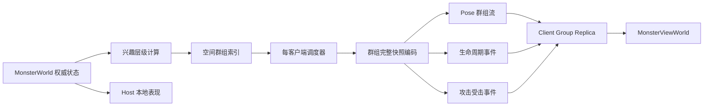

# 怪物网络层分层、分组、分频与传输重构方案

状态：方案基线  
适用范围：怪物权威模拟之后的远端表现同步、生命周期同步、攻击与受击表现事件  
设计目标：面向最终态重构，不保留旧的全量房间表现快照兼容路径

## 1. 方案结论

怪物网络层采用四个核心原则：

1. 权威模拟保持统一的 30 Tick/s。
2. 远端表现按照兴趣层级分频。
3. 服务器按照空间群组向每个客户端独立调度。
4. 第一版只发送群组级完整快照，不做 Dirty 增量。

当前怪物默认锁定玩家并持续移动，位置数据的变化频率很高。第一版先验证分组、分层和分频带来的收益，避免把增量基线、Dirty 检测、丢包恢复和插值逻辑同时引入。后续通过量化数据决定是否需要对位置、朝向和表现字段进一步做增量编码。

第一版的网络状态模型如下：

```text
房间全量快照
    -> 客户端兴趣集
    -> 空间群组
    -> 内层/中层/外层频率
    -> 群组级完整快照
    -> 1024 B 以内传输包
```

“完整快照”在第一版表示一个群组内所有当前成员的完整表现状态，不再表示整个房间的 10024 只怪物。

## 2. 当前基线与问题规模

### 2.1 最新完整矩阵

最新完整测试来自 RunId `20261110-131500-7a08b96a`，提交为 `31b9a0413578`，工作区干净。测试覆盖 1024、2048 和 5012 怪物，每档 3 次，Host 和 Client 均有效。

5012 档位的典型结果如下：

| 角色 | 平均帧间隔 | P95 帧间隔 | 平均 Main Thread | P95 Main Thread | 网络方向 |
|---|---:|---:|---:|---:|---:|
| Host | 5.97～6.02 ms | 16.74～16.94 ms | 5.91～6.01 ms | 16.74～16.93 ms | 发送约 454 KiB/s |
| Client | 6.49～6.57 ms | 8.50～8.54 ms | 6.48～6.56 ms | 8.50～8.53 ms | 接收约 454 KiB/s |

5012 Host 的主要 Marker 约为：

| Marker | 平均每次 |
|---|---:|
| `Monster.Simulation.EntityTick` | 5.76 ms |
| `Monster.Replication.Publish` | 5.55 ms |
| `Monster.Replication.ApplyLocal` | 3.38 ms |

### 2.2 10024 网络规模

之前有效的 10024 双端测试显示：

- 单个完整房间 Presentation 逻辑大小约 `61,405 B`。
- 发送频率约 `15 Hz`。
- Host 向单个远端客户端发送约 `903 KiB/s`。
- Client 接收约 `904 KiB/s`。
- Host `Monster.Replication.Publish` 平均每次约 `11 ms`。
- Host `Monster.Replication.ApplyLocal` 平均每次约 `6.8～7.0 ms`。

当前数据已经足以证明全量房间快照需要拆分。最新完整矩阵没有包含 10024 档位，因此网络重构完成后仍需要在当前提交上补跑 10024，作为最终对比档位。

### 2.3 当前传输语义

`MonsterNetworkTransport` 的 Presentation 注释写成了高频不可靠，但实际使用的是 `NetworkDeliveryClass.FullSnapshot`。通用 Transport 将其映射为 `ReliableFragmentedSequenced`。

当前实际路径是：

```text
高频
完整房间快照
可靠
有序
分片
```

10024 下一个业务消息约 60 KiB，底层 Transport 配置中的 `m_MaxPayloadSize = 6144` 只表示底层允许的消息上限，不能作为业务包设计目标。第一版将业务包限制在 1024 B 内，避免依赖高频可靠大分片。

## 3. 最终网络架构



### 3.1 权威状态

`MonsterWorld` 继续持有所有怪物的权威数据：

- Slot；
- 活跃状态；
- 配置索引；
- 位置；
- 朝向；
- 攻击序列；
- 受击序列；
- 当前空间群组；
- 当前兴趣层级。

网络层读取权威状态并编码。网络层不参与怪物移动、目标选择、导航或战斗结算。

### 3.2 Host 本地表现

Host 本地表现直接读取权威状态：

```text
MonsterWorld -> MonsterViewWorld
MonsterWorld -> Remote Group Scheduler
```

Host 不再把自己发送的网络快照重新交给 `MonsterReplica.Apply()`。这样可以移除 Host 自己的完整网络解码和本地 Replica 应用成本。

### 3.3 远端客户端表现

远端客户端只接收属于自身 InterestSet 的群组数据。客户端按照群组版本合并到本地 Replica，并为每个 Slot 保留最近两个表现状态用于插值。

## 4. 兴趣层级设计

兴趣层级只影响远端表现同步，不改变权威模拟频率。

### 4.1 内层

满足以下条件之一的怪物进入内层：

- 距离玩家处于近距离范围；
- 当前被玩家锁定；
- 当前攻击或受击；
- 刚生成或刚销毁；
- 处于需要高精度表现的战斗状态。

建议频率为 `15 Hz`，每 2 个 Gameplay Tick 发送一次。

### 4.2 中层

中层覆盖玩家附近但不直接参与当前交互的怪物。

建议频率为 `10 Hz`，每 3 个 Gameplay Tick 发送一次。

### 4.3 外层

外层覆盖仍属于房间兴趣范围，但距离较远的怪物。

建议频率为 `5 Hz`，每 6 个 Gameplay Tick 发送一次。

### 4.4 层级切换

层级切换采用两个阈值：进入阈值和离开阈值。两个阈值之间保留滞后带，防止怪物在边界附近反复切换。

攻击、受击、生成、销毁和群组迁移会临时提升同步优先级。事件处理结束后，怪物回到距离和兴趣状态决定的层级。

具体距离不在代码中散落写死，统一由网络配置提供：

```text
InnerEnterDistance
InnerLeaveDistance
MiddleEnterDistance
MiddleLeaveDistance
OuterInterestDistance
InterestRefreshHz
```

第一轮压测使用固定配置。后续根据客户端视野、战斗范围和网络预算调参。

## 5. 空间群组设计

### 5.1 群组来源

群组由空间 Cell 和 Cell 内的稳定 SubGroup 组成：

```text
CellX + CellZ + SubGroupIndex -> GroupId
```

空间 Cell 使用当前怪物空间索引已有的坐标体系。网络层复用空间查询结果，不重新遍历全部怪物建立兴趣集。

### 5.2 群组容量

第一版采用以下目标：

- 目标活跃成员数为 `96～128`；
- 单个业务包不超过 `1024 B`；
- 群组快照实际以字节数决定拆包；
- 大 Cell 按稳定规则拆成多个 SubGroup。

单个怪物当前表现状态包含 4 B PackedPose、1 B AttackSequence 和 1 B HitSequence，共 6 B。128 个状态约占 768 B，剩余空间用于群组头、成员索引和分包信息。

### 5.3 群组稳定性

每个群组维护：

```text
GroupId
GroupRevision
MembershipRevision
CurrentTier
MemberSlots
```

怪物跨越空间 Cell 时更新成员关系。成员变化不跟随每个 Pose 包重复发送，而是通过可靠的 GroupMembership 消息通知客户端。

群组容量变化时，使用确定性规则分配 SubGroup。规则必须只依赖 Cell 和 Slot，避免服务器重启或客户端重连后出现不同的群组映射。

## 6. 第一版快照模型

### 6.1 不做 Dirty 增量

第一版不维护位置 Dirty 位、不计算位置差值、不要求客户端确认基线。

一个群组到期时，服务器编码该群组当前所有活跃成员的完整状态：

```text
GroupSnapshot
    GroupId
    GroupRevision
    MembershipRevision
    ServerTick
    Tier
    MemberCount
    MemberStates[]
```

每个 `MemberState` 包含：

```text
LocalMemberIndex
PackedPose
AttackSequence
HitSequence
```

第一版的减少来源只有三项：

1. 客户端只接收自身 InterestSet；
2. 内层、中层、外层使用不同频率；
3. 一个房间快照拆成多个小群组快照。

### 6.2 群组快照分包

当一个群组快照超过 1024 B 时拆成多个业务包。每个包包含：

```text
ProtocolVersion
RoomGeneration
GroupId
GroupRevision
MembershipRevision
ServerTick
GroupFrameId
ChunkIndex
ChunkCount
MemberStateCount
MemberStates[]
```

客户端只有在同一个 `GroupFrameId` 的所有 Chunk 都收到后，才提交该群组快照。缺少任意 Chunk 时保留上一份已提交状态，避免半包覆盖完整状态。

Pose 群组包使用 `UnreliableSequenced`。丢失一轮群组快照时，下一轮完整群组快照可以直接恢复，不依赖上一轮数据。

### 6.3 Keyframe

第一版群组快照本身就是完整状态，因此不需要单独维护 Delta 基线。

以下情况触发群组 Keyframe：

- 客户端刚进入 InterestSet；
- GroupRevision 发生变化；
- 客户端请求重同步；
- 群组长时间没有成功提交完整快照。

Keyframe 仍然按 1024 B 拆包。初始进入兴趣范围时使用可靠有序事件。周期性恢复时可以继续使用不可靠有序群组包。

## 7. 生命周期与事件协议

### 7.1 RoomBegin

可靠有序消息，包含：

- 量化原点；
- 量化范围；
- 地面高度；
- 房间代数；
- 最小接受 Tick。

### 7.2 Spawn

Spawn 数据拆成多个可靠小包。每个包带有：

```text
SpawnBatchId
ChunkIndex
ChunkCount
StartSlot
Count
SpawnItems[]
```

客户端完成完整 Spawn 批次后，才将对应 Slot 标记为可接收表现状态。

### 7.3 Despawn

Despawn 使用可靠事件消息。由于当前房间内 Slot 不复用，客户端可以直接将指定 Slot 置为非活跃。

### 7.4 GroupMembership

GroupMembership 使用可靠有序消息。内容包括：

```text
GroupId
MembershipRevision
MemberSlots[]
```

客户端收到新成员关系后重建该群组的本地成员映射。Pose 包中的 `MembershipRevision` 用于防止旧成员关系覆盖新状态。

### 7.5 Attack 和 Hit

攻击和受击表现事件使用小型可靠有序消息：

```text
Slot
EventSequence
EventType
ServerTick
```

位置快照仍然携带当前 AttackSequence 和 HitSequence，客户端可以在重同步后恢复表现状态。事件消息用于保证事件及时触发，状态字段用于恢复。

### 7.6 RoomEnd

可靠有序消息。客户端收到后清理房间 Replica、群组状态和表现层状态。

## 8. 每客户端 InterestSet

表现同步从广播模型改为每客户端独立调度：

```text
Authority World
    -> Client A InterestSet
    -> Client B InterestSet
    -> Client C InterestSet
```

每个客户端的 InterestSet 由以下内容决定：

- 对应玩家位置；
- 玩家关注目标；
- 空间 Cell；
- 视野和战斗范围；
- 怪物当前层级；
- 事件优先级；
- 群组是否需要 Keyframe。

InterestSet 不需要每个 Tick 完整重算。第一版以 `5 Hz` 更新层级和群组选择，位置群组按照各层频率发送。

发送接口从：

```csharp
SendToRemoteClients(...)
```

调整为每客户端发送：

```csharp
SendToClient(clientId, ...)
```

这样不同客户端可以拥有不同的 InterestSet 和发送预算。

## 9. 调度器设计

每个客户端维护一个调度器。调度器只处理网络表现，不参与权威模拟。

每个 30 Hz Tick 执行以下步骤：

1. 收集本 Tick 到期的群组；
2. 加入发生生命周期或战斗事件的 Slot；
3. 根据兴趣层级和事件状态计算优先级；
4. 按 1024 B 上限组装业务包；
5. 采用轮询保证外层群组不会永久饥饿；
6. 发送本 Tick 允许的包数；
7. 更新群组最后发送 Tick 和统计信息。

优先级顺序如下：

```text
生命周期事件
攻击与受击事件
内层群组
中层群组
外层群组
恢复 Keyframe
```

当本 Tick 预算不足时，低优先级群组延后到下一次调度。延后次数需要记录，避免网络持续拥塞时外层群组永远得不到发送机会。

## 10. 发送预算与包大小

第一版使用这些限制：

```text
Gameplay Tick                 30 Hz
InterestSet Refresh           5 Hz
Inner Pose                    15 Hz
Middle Pose                   10 Hz
Outer Pose                    5 Hz
业务包最大长度                1024 B
群组快照最大单包长度          1024 B
```

单个业务包长度包含自定义协议头。业务层不构造超过 1024 B 的 Presentation、Spawn 或 GroupMembership 包。

Transport 层仍可能受到自身头部、MTU 和平台配置影响，因此需要分别记录：

```text
LogicalPayloadBytes
TransportPayloadBytes
PacketCount
FragmentCount
SendQueuePeak
RetransmitCount
```

第一版验收时不把 6144 B 的 Transport 上限当作业务预算，也不依赖高频可靠大分片完成表现同步。

## 11. 客户端 Replica

客户端保留每个 Slot 的表现状态：

```text
PreviousPose
CurrentPose
LatestServerTick
AttackSequence
HitSequence
IsActive
```

客户端同时维护每个群组的：

```text
GroupRevision
MembershipRevision
LatestServerTick
LastCommittedFrameId
LastReceiveTime
```

群组快照提交流程如下：

1. 校验 RoomGeneration；
2. 校验 GroupRevision；
3. 校验 MembershipRevision；
4. 将 Chunk 写入临时群组缓冲；
5. 所有 Chunk 到齐后提交完整群组帧；
6. 将群组成员的 CurrentPose 推入 PreviousPose；
7. 更新攻击和受击序列；
8. 更新群组接收 Tick。

旧群组帧不会覆盖新帧。未出现在新群组帧中的成员按照当前 MembershipRevision 处理，不能把旧成员关系中的 Slot 继续应用到新群组。

## 12. 插值和表现层

插值仍然由 `MonsterViewWorld` 和 VAT 表现层处理。网络层只提供每个 Slot 的前后状态。

不同层级使用不同的插值窗口：

- 内层使用短插值窗口；
- 中层使用中等插值窗口；
- 外层使用较长插值窗口；
- 长时间没有新帧时保持最后状态，等待 Keyframe 恢复。

网络层不创建 GameObject。View 层继续使用当前 Slot 驱动的 VAT 批量渲染结构。

## 13. 代码职责调整

最终代码应围绕以下职责组织：

### MonsterInterestSet

维护一个客户端当前关注的群组和 Slot 层级。

### MonsterNetworkGroupIndex

根据空间 Cell 和 Slot 建立稳定 GroupId，处理成员迁移和 MembershipRevision。

### MonsterReplicationScheduler

按客户端、层级、Tick 和发送预算选择待发送群组。

### MonsterGroupSnapshot

保存一个群组在某个 ServerTick 的完整成员表现状态。

### MonsterGroupSnapshotCodec

负责群组快照、Chunk、生命周期事件和表现事件的编码解码。

### MonsterGroupReplica

在客户端暂存和提交群组快照，维护 Chunk 组装和 GroupRevision。

### MonsterNetworkTransport

只负责消息注册、Delivery 选择、发送和接收，不决定兴趣层级和群组调度。

### MonsterRuntimeService

负责在 Gameplay Tick 阶段调用权威模拟、Host 本地表现和远端复制调度。

这些职责可以落在现有文件中进行重构，不要求为每个职责创建独立接口。拆分的依据是数据所有权和 Tick 生命周期。

## 14. 实施顺序

### 阶段一，替换数据模型

完成以下内容：

- GroupId；
- GroupRevision；
- MembershipRevision；
- GroupSnapshot；
- GroupSnapshotChunk；
- GroupEvent；
- 客户端 GroupReplica。

这一阶段直接面向最终态设计，不保留旧 `MonsterPresentationFrame` 的房间级兼容路径。

### 阶段二，接入空间群组

完成以下内容：

- 复用现有空间索引确定 Cell；
- 建立稳定 SubGroup；
- 维护群组成员关系；
- 发送 GroupMembership；
- 验证 Slot 与 GroupId 的一致性。

### 阶段三，接入群组级完整快照

完成以下内容：

- 群组完整状态编码；
- 1024 B Chunk 拆分；
- 客户端完整 Chunk 组装；
- Pose 使用 UnreliableSequenced；
- Keyframe 和重同步。

### 阶段四，接入分层频率

完成以下内容：

- 内层 15 Hz；
- 中层 10 Hz；
- 外层 5 Hz；
- InterestSet 5 Hz 更新；
- 发送预算和公平调度。

### 阶段五，拆分生命周期和表现事件

完成以下内容：

- Spawn Chunk；
- Despawn Event；
- GroupMembership Event；
- Attack Event；
- Hit Event；
- RoomEnd Event。

### 阶段六，移除 Host 本地网络应用路径

完成以下内容：

- Host View 直接读取权威状态；
- 删除 Host `Replica.Apply()` 路径；
- 删除全量 `ApplyLocal` 逻辑；
- 保留 Client GroupReplica 作为远端状态入口。

## 15. 第一版不引入的内容

以下内容等第一版基线稳定后再决定：

- Dirty Pose 位；
- 算术位置 Delta；
- 上一帧确认基线；
- XOR 或字典压缩；
- 攻击和受击字段的进一步位压缩；
- 跨群组批量压缩；
- 面向多个客户端的共享编码缓存。

第一版采用群组完整快照后，需要通过数据决定增量是否值得引入。重点观察：

```text
每个群组平均活跃数
每个群组每次发送字节数
群组频率降低后的总 Payload
群组完整快照 CPU
单帧网络峰值
Client P95
```

如果怪物在持续追击玩家的状态下，群组完整快照已经将 Host P95、Client P95 和带宽降到目标范围，则继续保持简单协议。如果带宽仍然过高，再按字段分别评估位置、朝向、攻击序列和受击序列的增量收益。

## 16. 量化 Marker 和统计项

### Host

```text
Monster.Network.InterestRefresh
Monster.Network.GroupBuild
Monster.Network.GroupMembership
Monster.Replication.Schedule
Monster.Presentation.GroupCapture
Monster.Presentation.GroupSerialize
Monster.Network.SendGroupSnapshot
Monster.Network.SendGroupSnapshot.Transport
Monster.Network.SendLifecycle
Monster.Network.SendEvent
```

### Client

```text
Monster.Network.ReceiveGroupSnapshot
Monster.Presentation.GroupDecode
Monster.Presentation.GroupAssemble
Monster.Replication.GroupApply
Monster.Network.ReceiveLifecycle
Monster.Network.ReceiveEvent
```

### 业务统计

```text
InterestGroupCount
InnerGroupCount
MiddleGroupCount
OuterGroupCount
GroupSnapshotCount
GroupChunkCount
GroupStateCount
LifecycleEventCount
AttackEventCount
HitEventCount
LogicalPayloadBytes
TransportPayloadBytes
PacketCount
FragmentCount
SendQueuePeak
StaleGroupCount
MissingChunkCount
ResyncRequestCount
```

## 17. 阶段性验收标准

### 群组阶段

- 单个业务包不超过 1024 B；
- 10024 怪物下不再出现 60 KiB Presentation 业务消息；
- 群组 Chunk 丢失时不会提交半个群组状态；
- GroupRevision 不连续时可以恢复；
- Host 和 Client 的活跃 Slot 数保持一致。

### 分频阶段

- 内、中、外层频率符合配置；
- 外层群组不会长期饥饿；
- Host `Replication.Publish` P95 下降；
- Host Main Thread P95 下降；
- Client `ReceiveApply` 和 `Presentation.Apply` 下降；
- 总带宽和单帧峰值分别记录。

### Host 直连阶段

- Host 不再执行自身网络快照的 Replica.Apply；
- Host `ApplyLocal` Marker 消失或只保留远端调试路径；
- Host 本地表现与权威状态一致；
- 远端客户端仍然可以通过 GroupReplica 正确插值。

## 18. 增量方案的引入条件

完成群组完整快照和分频后，使用同样场景、同样怪物数量、同样路线进行量化：

1. 记录每个群组完整快照平均字节数。
2. 记录怪物状态变化比例。
3. 记录位置、朝向、攻击和受击字段分别变化的比例。
4. 比较 Dirty 检测成本和节省的序列化字节。
5. 比较客户端丢包恢复复杂度和插值质量。

只有当增量编码同时降低总 Payload 和 CPU 成本时，才进入下一阶段。第一版不因为理论上的带宽收益提前引入增量依赖。

## 19. 当前执行顺序

1. 在当前 `31b9a04` 上补跑完整 10024 双端基线。
2. 按本方案实现空间群组和群组完整快照。
3. 完成 1024、2048、5012、10024 四档验证。
4. 加入内、中、外层分频。
5. 重新验证带宽、Host P95、Client P95 和一致性。
6. 移除 Host 本地 Replica.Apply 路径。
7. 根据实测结果决定是否引入 Dirty 增量。

该顺序保持每一步的性能收益和协议正确性可独立验证，也符合当前怪物持续追击玩家、位置状态高频变化的实际逻辑。
